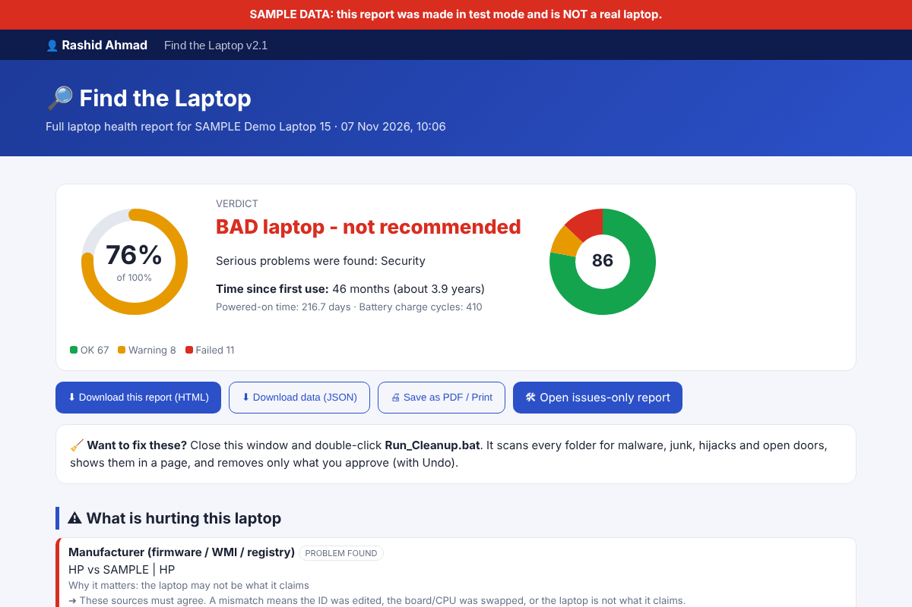

<div align="center">

# 🔎 Find the Laptop

### Buying a used laptop? Don't trust the seller. Trust the scan.

**One double-click. One honest report. Hardware health, fake-spec detection and security checks for any Windows laptop.**

[](https://github.com/YOUR-USERNAME/FindTheLaptop/actions/workflows/ci.yml)


[](LICENSE)



<sub>Sample report generated in test mode with fake data. It is not a real laptop.</sub>

</div>

---

## Why this exists

A used laptop can look perfect and still hide a worn-out battery, a dying disk, a changed serial number, a pirated Windows, or malware. Most buyers have no way to check. **Find the Laptop** gives anyone, with no technical knowledge, a clear verdict they can use before paying.

## What you get

| | |
|---|---|
| 🩺 **Health score & verdict** | A simple percentage and a plain-English verdict, with the problems explained. |
| 🔋 **Battery, disk, RAM, CPU** | Battery wear and cycles, disk health and hours, RAM pattern test, CPU speed and overheating test. |
| 🕵️ **Fake-spec detection** | Cross-checks model, serial, BIOS, CPU and RAM across firmware, WMI, registry and the chip itself (CPUID) to catch edited identities. |
| 🛡️ **Security audit** | Defender status, hidden exclusions, odd services and scheduled tasks, unsigned drivers, cracks, fake activation (KMS), remote-control tools. |
| 📅 **Real age estimate** | Estimates months since first use from several independent dates, not just the Windows install date. |
| 🔊 **Hardware tests** | Speaker and microphone loopback, camera check, stuck-key check, plus a manual checklist for what software cannot judge. |
| 🧹 **Cleaner (optional)** | Finds malware, hijacks, junk and open doors. Nothing changes until you tick it, type `CLEAN` and approve. Everything is undoable. |
| 📴 **Works offline** | Charts are drawn inside the report. Libraries can be cached for offline use. |

## Quick start

> Requires **Windows 10 or 11**. Python and the C/C++ tools are installed automatically if missing.

1. **Download** this repository (green **Code** button, then **Download ZIP**) and extract the **whole** folder. Do not run it from inside the ZIP.
2. **Double-click** `Run_FindTheLaptop.bat`.
3. Type **`F`** (full check) or **`Q`** (quick check) and click **Yes** on the Administrator prompt.
4. Your browser opens the report automatically.

Want to clean the laptop too? Double-click **`Run_Cleanup.bat`**.

Prefer the command line?

```bash
git clone https://github.com/YOUR-USERNAME/FindTheLaptop.git
cd FindTheLaptop
Run_FindTheLaptop.bat
```

## Preview the report without scanning anything

Test mode fills the report with sample data so you can see the layout. It also runs on Linux with Python 3.

```bash
# Linux
FTL_DEMO=1 python3 findthelaptop.py --consented --quick
```

```bat
:: Windows (cmd)
set FTL_DEMO=1
python findthelaptop.py --consented --quick
```

Never use test mode for a real buying decision.

## Safety and privacy

- **Nothing is uploaded.** Reports stay in the `Reports` folder on your machine.
- **Internet is used only** to install missing tools, check the clock against a public server, and run a speed test. It is skipped when offline.
- **Your security settings are never changed by the scanner.** If something must change, the report tells you what.
- **The Cleaner is approval-based.** It only acts on items you tick, quarantines instead of deleting, creates a restore point, backs up every change and offers "Undo everything". Its local page listens on `127.0.0.1` only, behind a secret token.
- 🛡️ **Antivirus may warn.** The tool contains malware-detection patterns and runs scripts as Administrator, which some antivirus products treat cautiously. The full source is visible so you can read it before you run it. Never disable your antivirus to run it.
- ⚠️ **Reports contain the serial number and Windows product key.** Do not post them publicly.

### Honest limits

- The report shows what **software can see**. It is not a lab test.
- Pressing every key, dead pixels, physical ports and hinges still need a human, so the report includes a manual checklist.
- The Cleaner uses heuristics and asks Windows Defender to confirm. It is **not a replacement for a full antivirus**. A rootkit can hide from any user-mode scanner; if the report shows "Hidden connections", run a Defender Offline scan.
- Use at your own risk. See the [LICENSE](LICENSE).

## How it works

Python orchestrates the scan, small **C / C++ probes** read the truth straight from the hardware (CPUID, RAM and disk tests, TCP table, fast file scanner), and **PowerShell / CMD / VBScript** collect Windows facts. Every step has a fallback, so one failing check never stops the scan. Full details in [`docs/HOW_IT_WORKS.md`](docs/HOW_IT_WORKS.md).

## Project structure

```
FindTheLaptop/
├── Run_FindTheLaptop.bat     # start the health scan
├── Run_Cleanup.bat           # start the cleaner
├── Prepare_Offline.bat       # cache libraries for offline use
├── Launcher.ps1              # PowerShell launcher (installs tools, runs Python)
├── findthelaptop.py          # scanner entry point and report builder
├── ftl_engines.py            # hardware and system engines
├── ftl_engines2.py           # authenticity, registry, camera, clock checks
├── ftl_charts.py             # offline SVG charts
├── ftl_queries.py            # extra PowerShell queries
├── ftl_cleaner.py            # cleaner entry point
├── ftl_clean_*.py            # cleaner: core, scanners, web page, actions
├── ftl_demo.py               # sample data for test mode
├── native/                   # C and C++ probes (compiled on the fly)
├── docs/                     # user guide, architecture, images
├── .github/                  # CI workflow and issue templates
└── requirements.txt
```

## Documentation

- 📘 [User guide](docs/USER_GUIDE.md): every feature explained
- 🧠 [How it works](docs/HOW_IT_WORKS.md): architecture and design choices
- 📝 [Changelog](CHANGELOG.md)
- 💬 [Feedback and bug reports](CONTRIBUTING.md)
- 🔐 [Security policy](SECURITY.md)

## Feedback

Bug reports and ideas are welcome through [Issues](../../issues). This project is developed only by its author, so pull requests are not accepted. See [CONTRIBUTING.md](CONTRIBUTING.md). Found a security problem? Follow [SECURITY.md](SECURITY.md) instead of opening a public issue.

## License

**Copyright (c) 2026 Rashid Ahmad. All rights reserved.**

You may download and run Find the Laptop for your own personal use. You may read the source code. You may **not** modify it, copy it, republish it, redistribute it, or sell it without written permission. See the full terms in [LICENSE](LICENSE).

## Author

Created and maintained by **Rashid Ahmad**, founder of Find the Laptop.


---

<div align="center">

**If this saved you from a bad laptop, give it a ⭐. It helps others find it.**

</div>
